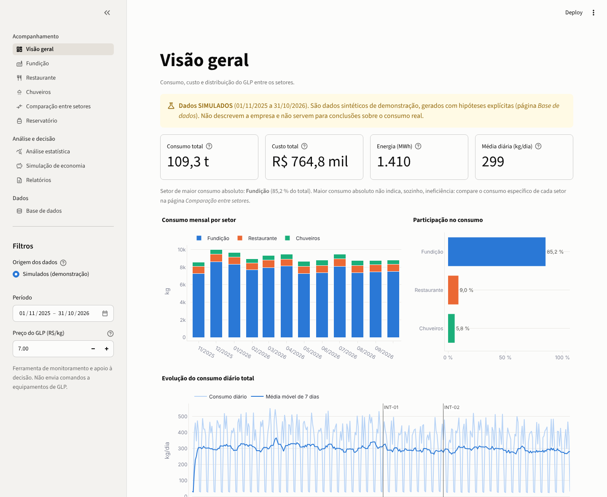
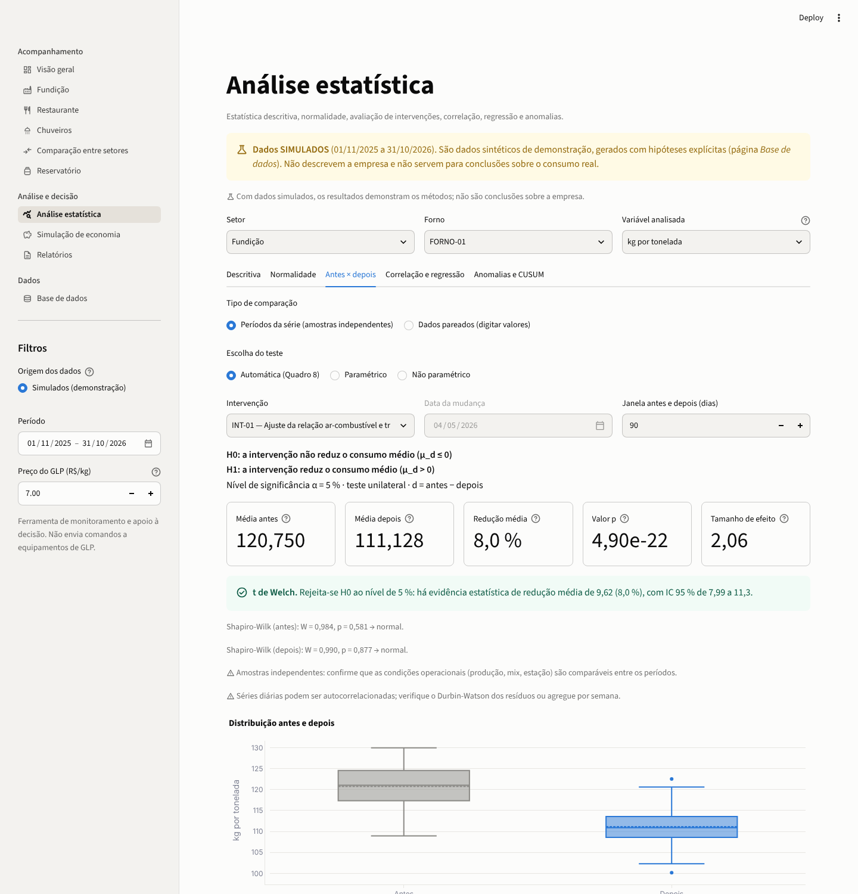

# Sistema inteligente de monitoramento, análise estatística e otimização do consumo de GLP industrial

**Instituição:** CEUNSP · **Curso:** Engenharia Elétrica · **Disciplina:** Experimentação e Análise de Dados
**Aluno:** Vitor Henrique Santos Das Virgens · **Ano:** 2026

Ferramenta de monitoramento e apoio à decisão para o consumo de GLP em três setores de uma indústria mecânica:
**fundição de peças**, **restaurante industrial** e **aquecimento de água dos chuveiros**.
O sistema mede, analisa e recomenda. **Não envia comandos** a reguladores, válvulas, queimadores ou dispositivos de segurança.



> **Dados de demonstração.** O repositório traz apenas dados **SIMULADOS**, gerados a partir de hipóteses explícitas
> ([`config/hipoteses_simulacao.toml`](config/hipoteses_simulacao.toml) e
> [`dados/dados_simulados/HIPOTESES.md`](dados/dados_simulados/HIPOTESES.md)).
> Eles não descrevem nenhuma empresa. Conclusões sobre o consumo real dependem da importação de dados medidos.

## Situação das fases

| Fase | Conteúdo | Situação |
|---|---|---|
| 1 – Pesquisa | Fundamentação técnica, fórmulas, indicadores e métodos estatísticos | Concluída |
| 2 – Diagnóstico | Análise do repositório existente | Concluída |
| 3 – Modelagem | Estrutura de dados, parâmetros com origem, validações | Concluída |
| 4 – Desenvolvimento | Módulos Python, painel Streamlit e linha de comando | Concluída |
| 5 – Testes | 65 testes automatizados (cálculos, estatística, dados, painel) | Concluída |
| 6 – Documentação | Este README e o relatório ABNT | Concluída |
| 7 – Validação | Limitações, hipóteses e requisitos para implantação | Concluída (no relatório) |

O relatório completo, formatado pelas normas ABNT, está em
[`documentos/Relatorio_Projeto_GLP_ABNT.docx`](documentos/Relatorio_Projeto_GLP_ABNT.docx)
(e em [PDF](documentos/Relatorio_Projeto_GLP_ABNT.pdf)).

## Instalação

Requer Python 3.11 ou mais recente.

```bash
cd projeto_glp
python -m venv .venv
source .venv/bin/activate            # Windows: .venv\Scripts\activate
pip install -r requirements.txt
```

## Execução

```bash
cd projeto_glp
streamlit run dashboard.py           # ou: python main.py painel
```

O painel abre em `http://localhost:8501`. Na primeira execução, o banco `dados/glp.db` é criado com os dados simulados.

Linha de comando:

```bash
python main.py gerar-simulados                        # (re)gera os dados SIMULADOS a partir das hipóteses
python main.py importar dados/dados_reais/jan.xlsx    # valida uma planilha (não grava)
python main.py importar dados/dados_reais/jan.xlsx --gravar
python main.py resumo --origem SIMULADO --saida resultados/resumo.md   # relatório .md + planilha .xlsx
python -m pytest                                       # testes automatizados
```

## Páginas do painel

| Página | O que mostra |
|---|---|
| Visão geral | Consumo, custo e energia totais; consumo mensal por setor; participação; evolução diária; alertas |
| Fundição | kg/h, kg/t, kg/ciclo, R$/t e tempo sem carga por forno; modelo G = β₀ + β₁·horas + β₂·t; eficiência estimada |
| Restaurante | kg/refeição, parcela fixa diária, comparação por faixa de refeições, perfil horário, consumo com a cozinha fechada |
| Chuveiros | kg/usuário, perfil horário, consumo em horas sem uso, relação com a temperatura da água, calculadora de demanda |
| Comparação entre setores | Consumo, custo, consumo específico, evolução em índice (base 100) e comparação entre períodos |
| Reservatório | Estoque **virtual** por balanço de massa, autonomia, abastecimentos e conciliação com o indicador do tanque |
| Análise estatística | Descritiva, Shapiro-Wilk, antes × depois (t pareado, Welch, Wilcoxon, Mann-Whitney), correlação, regressão, anomalias, CUSUM |
| Simulação de economia | Cenários de redução (3 % a 25 %) com preço, consumo, dias e investimento editáveis, sempre rotulados como SIMULAÇÃO |
| Relatórios | Avaliação das intervenções registradas e exportação em Excel e Markdown |
| Base de dados | Importação e validação de CSV/Excel, consulta, planilha-modelo e hipóteses dos dados simulados |



## Como usar dados reais

1. Baixe a planilha-modelo na página **Base de dados** (ou veja `src/importacao.py`).
2. Preencha um registro por dia (ou por hora) e por equipamento, com `origem = MEDIDO`.
3. Importe pela página **Base de dados** ou com `python main.py importar <arquivo> --gravar`.
4. Na barra lateral, escolha **Medidos (empresa)**. Medidos e simulados nunca entram na mesma análise.
5. Atualize em `config/parametros.toml` os valores marcados como `HIPOTESE`: preço do GLP (nota fiscal),
   capacidade e limite de enchimento do tanque (placa e fabricante), propriedades da liga, parâmetros dos chuveiros.

Colunas do registro de consumo:

| Coluna | Obrigatória | Observação |
|---|---|---|
| `data` | sim | AAAA-MM-DD, não futura |
| `hora` | não | HH:MM, para perfis horários |
| `setor` | sim | FUNDICAO, RESTAURANTE, CHUVEIROS ou GERAL |
| `equipamento_id` | não | deve existir no cadastro |
| `consumo_valor`, `consumo_unidade` | sim | kg, t ou m3 (m³ só com fator kg/m³ do fornecedor) |
| `atividade_valor`, `atividade_unidade` | não | t, ciclos, refeicoes, usuarios ou banhos, compatível com o setor |
| `tempo_funcionamento_h`, `tempo_sem_carga_h`, `ciclos`, `temperatura_c` | não | variáveis explicativas |
| `origem` | sim | MEDIDO |
| `observacoes` | não | livre |

A validação rejeita campos obrigatórios vazios, valores negativos, datas inválidas ou futuras, unidades incompatíveis
e mistura de origens; avisa sobre duplicados, equipamentos não cadastrados, consumo acima da potência nominal e
lacunas na série. Nada é corrigido silenciosamente.

## Fórmulas principais

| Equação | Uso |
|---|---|
| E = m · PCI, com PCI = 11.100 kcal/kg = 12,91 kWh/kg (ANP, 2026) | energia do GLP |
| C = m · p | custo |
| CE = m / A | consumo específico (kg/t, kg/refeição, kg/usuário) |
| Economia = (G_LB,aj − G_rel) ± Aj_NR (PIMVP) | economia verificada |
| Q_útil = m·[cₛ(T_f − T₀) + L_f + cₗ(T_v − T_f)]; η = Q_útil / (m_GLP · PCI) | eficiência do forno |
| Q = ρ·V·c·ΔT; m_GLP = Q / (η · PCI) | demanda dos chuveiros |
| S_t = S_{t−1} + A_t − G_t; Aut = (S_t − S_res) / Ḡ | reservatório virtual |

A dedução, as fontes e os métodos estatísticos estão no relatório ABNT.

## Estrutura

```
projeto_glp/
├── config/                 parâmetros (com origem) e hipóteses da simulação
├── dados/
│   ├── dados_reais/        planilhas da empresa (não versionadas)
│   ├── dados_simulados/    CSV SIMULADOS + HIPOTESES.md
│   └── referencias/        parâmetros de referência com fonte
├── documentos/             relatórios ABNT, figuras e gerador dos relatórios
├── src/                    módulos: importacao, validacao, banco_dados, indicadores, estatistica,
│                           anomalias, alertas, fundicao, restaurante, chuveiros, reservatorio,
│                           simulacao, relatorios, dados_simulados, painel, constantes
├── paginas/                páginas do painel Streamlit
├── tests/                  testes automatizados (pytest)
├── dashboard.py            entrada do painel
├── main.py                 linha de comando
└── requirements.txt
```

## Regras do projeto

- Nenhum dado da empresa é inventado. Sem medição, usam-se dados **SIMULADOS**, identificados e com hipóteses explícitas.
- Estimativas não são apresentadas como medições. Todo parâmetro tem origem: REFERENCIA, EMPRESA ou HIPOTESE.
- Consumo absoluto maior não é, sozinho, prova de ineficiência: o consumo é normalizado pela atividade.
- Uma redução percentual isolada não prova melhoria: a avaliação usa teste de hipóteses, IC 95 % e verificação de comparabilidade.
- Ajustes em equipamentos de GLP são recomendações para avaliação por profissionais habilitados.

## Gerar o relatório ABNT

```bash
pip install python-docx
python documentos/gerador/relatorio_projeto_glp.py
```

Com LibreOffice (`soffice`) e Poppler (`pdftotext`) instalados, o sumário é numerado automaticamente e o PDF é gerado.
Antes de entregar, complete `[Cidade]` e o nome do(a) professor(a) nas constantes `CIDADE` e `ORIENTADOR` do gerador.

Os exercícios da disciplina de Programação em Python, na raiz do repositório, não foram alterados.
